# LoomTrack database schema

SQLite, 25 tables, defined in [backend/loomtrack/db.py](../backend/loomtrack/db.py). The schema is normalised (third normal form) apart from two deliberate caches. The diagram below is a Mermaid ER diagram: it renders on GitHub, and in VS Code with the "Markdown Preview Mermaid Support" extension.

`PK` primary key, `FK` foreign key, `UK` unique. `||--o{` means one-to-many.

```mermaid
erDiagram
    buyers ||--o{ orders : "places"
    units ||--o{ orders : "runs"
    units ||--o{ users : "employs supervisors"
    buyers ||--o{ users : "has sign-in accounts"
    units ||--o{ milestones : "does stage"
    users ||--o{ sessions : "signs in"
    users ||--o{ orders : "merchandises"
    users ||--o{ daily_updates : "submits"
    orders ||--|{ order_sizes : "has sizes"
    orders ||--|{ milestones : "has TNA plan"
    plan_steps ||--o{ milestones : "defines the step"
    templates ||--|{ template_steps : "has steps"
    plan_steps ||--o{ template_steps : "used in"
    users ||--o{ templates : "created"
    buyers ||--o{ order_requests : "sends"
    orders ||--o| order_requests : "accepted as"
    order_requests ||--|{ request_sizes : "asks for"
    order_requests ||--|{ request_messages : "conversation"
    users ||--o{ request_messages : "wrote"
    order_requests ||--o{ attachments : "has files"
    orders ||--o{ attachments : "has files"
    orders ||--o{ daily_updates : "receives"
    milestones ||--o{ daily_updates : "progress on"
    daily_updates ||--o{ photos : "has"
    daily_updates ||--o| issue_reasons : "classified as"
    orders ||--o{ warnings : "raises"
    orders ||--o{ date_changes : "audited by"
    milestones ||--o{ date_changes : "date moved"
    buyers ||--o{ outbox_messages : "emailed"
    orders ||--o{ outbox_messages : "about"
    buyers ||--o{ buyer_visits : "opens its pages"
    units ||--o{ unit_capacity : "capacity per stage"

    buyers {
        INTEGER id PK
        TEXT name
        TEXT country
        TEXT link_token UK "buyer credential"
        INTEGER link_active "1 = link works"
        INTEGER notify_email "1 = email the buyer's people"
        TEXT whatsapp_number "E.164"
        INTEGER whatsapp_opt_in "1 = the buyer agreed"
        TEXT whatsapp_opt_in_at
        INTEGER whatsapp_opt_in_by FK
    }
    units {
        INTEGER id PK
        TEXT name
        TEXT kind "own or subcontract"
        TEXT process "printing or washing"
        INTEGER daily_capacity "pieces a day it can stitch; own units (other stages: unit_capacity)"
    }
    unit_capacity {
        INTEGER unit_id PK, FK
        TEXT process PK "cutting, finishing, packing ..."
        INTEGER daily_capacity "pieces a day"
    }
    users {
        INTEGER id PK
        TEXT name
        TEXT role "merchandiser, supervisor or buyer"
        TEXT login UK "email or phone"
        TEXT secret_hash "scrypt"
        INTEGER unit_id FK "supervisors only"
        TEXT lang "en or ta"
        INTEGER buyer_id FK "buyer accounts only"
        INTEGER must_change_secret "1 until the buyer picks their own"
        INTEGER can_write "0 = a buyer account that can look but not send or change"
        TEXT phone "office accounts: a contact number, E.164"
    }
    sessions {
        TEXT token PK "SHA-256 of the session token, never the token"
        INTEGER user_id FK
        TEXT expires_at
    }
    orders {
        INTEGER id PK
        TEXT order_no UK "our number, LT-2026-0001"
        TEXT po_no "buyer's PO; unique per buyer"
        INTEGER buyer_id FK
        TEXT style
        TEXT colour "name"
        TEXT colour_pantone "optional reference"
        TEXT colour_hex "optional swatch, #RRGGBB"
        TEXT fabric_type "optional"
        TEXT fabric_composition "optional"
        INTEGER fabric_gsm "50 to 800, optional"
        TEXT fabric_note "optional"
        INTEGER qty_total "greater than 0"
        TEXT ex_factory
        INTEGER unit_id FK
        TEXT template_key
        INTEGER merchandiser_id FK
        TEXT state "active, shipped, cancelled"
        TEXT status "cached green, amber, red"
        TEXT projected_ex_factory "cached"
        TEXT status_computed_at
        TEXT cancel_reason "why the merchandiser cancelled; shown to the buyer"
        TEXT cancelled_at
        TEXT shipped_date "the day it left the factory; set by Mark shipped"
        TEXT production_complete_at "app date the last stage reached the full quantity"
        TEXT created_at
    }
    order_sizes {
        INTEGER order_id PK, FK
        TEXT size PK
        INTEGER seq
        INTEGER qty
    }
    plan_steps {
        TEXT code PK
        TEXT name_en
        TEXT name_ta
        TEXT kind "milestone or stage"
        TEXT process "stages only"
        INTEGER builtin "1 = defined in code"
    }
    templates {
        INTEGER id PK
        TEXT key UK "stored on orders.template_key"
        TEXT name "unique among active"
        INTEGER builtin "built-ins are read-only"
        INTEGER active "0 = retired"
        INTEGER created_by FK
        TEXT created_at
        TEXT updated_at
    }
    order_requests {
        INTEGER id PK
        TEXT request_no UK "RQ-2026-0001"
        TEXT kind "new_order or amendment"
        INTEGER buyer_id FK
        INTEGER order_id FK "set once accepted"
        TEXT po_no "buyer's PO"
        TEXT style
        TEXT description
        TEXT colour
        TEXT colour_pantone
        TEXT colour_hex
        TEXT fabric_type "same four fields as orders"
        TEXT fabric_composition
        INTEGER fabric_gsm
        TEXT fabric_note
        TEXT ex_factory "asked for or agreed"
        TEXT status "submitted, query, countered, accepted, declined, withdrawn"
        INTEGER decided_by FK
        TEXT decided_at
        TEXT created_at
        TEXT updated_at
    }
    request_sizes {
        INTEGER request_id PK, FK
        TEXT size PK
        INTEGER seq
        INTEGER qty
    }
    request_messages {
        INTEGER id PK
        INTEGER request_id FK
        TEXT author "buyer or merchandiser"
        INTEGER user_id FK
        TEXT event "submitted, message, query, counter, agreed, accepted, declined, withdrawn"
        TEXT body
        TEXT proposed_ex_factory
        TEXT created_at
    }
    attachments {
        INTEGER id PK
        INTEGER request_id FK "a request, an order, or both"
        INTEGER order_id FK
        TEXT kind "design, pattern, print, fabric, other"
        TEXT filename "display only"
        TEXT mime "from the file's bytes"
        INTEGER size_bytes
        TEXT sha256
        TEXT path "random name on disk"
        TEXT uploaded_by "buyer or merchandiser"
        INTEGER user_id FK
        INTEGER buyer_visible
        INTEGER supervisor_visible
        TEXT created_at
    }
    template_steps {
        INTEGER template_id PK, FK
        TEXT code PK, FK "step"
        INTEGER seq UK "order within the template"
        INTEGER end_offset "days before ex-factory"
        INTEGER start_offset "stages only; bigger than end"
        TEXT after_code FK "stages only: starts the day after this step ends"
    }
    milestones {
        INTEGER id PK
        INTEGER order_id FK
        TEXT code UK, FK "step; unique per order"
        INTEGER seq
        TEXT planned_start
        TEXT planned_date
        TEXT actual_date "null until done"
        INTEGER unit_id FK
    }
    daily_updates {
        TEXT id PK "made on the phone"
        INTEGER milestone_id FK "order is milestones.order_id"
        INTEGER user_id FK
        TEXT work_date
        INTEGER qty
        TEXT note_text
        TEXT note_source "text, or voice (written out by Whisper)"
        TEXT audio_path
        TEXT created_at_client
        TEXT received_at
    }
    photos {
        INTEGER id PK
        TEXT update_id FK "required"
        TEXT path
        TEXT mime
        INTEGER buyer_visible
        TEXT created_at
    }
    issue_reasons {
        TEXT update_id PK, FK
        TEXT ai_category
        TEXT ai_translation
        REAL ai_confidence
        TEXT ai_source "indictrans2 or keywords"
        TEXT ai_error
        TEXT final_category "human decision"
        INTEGER changed_by FK
        TEXT changed_at
        TEXT classified_at
    }
    warnings {
        INTEGER id PK
        INTEGER order_id FK
        TEXT level "amber or red"
        TEXT projected_ex_factory
        INTEGER slack_days
        TEXT summary "internal maths"
        TEXT buyer_message
        TEXT state "pending, confirmed, dismissed, superseded, resolved"
        INTEGER decided_by FK
        TEXT decided_at
        TEXT created_at
        TEXT buyer_seen_at "when the buyer first opened the notice"
        TEXT buyer_ack_at "when the buyer acknowledged it"
        TEXT buyer_ack_note "what the buyer wrote when acknowledging"
        TEXT reason_category "the floor reason the message was written around"
        TEXT warned_on "app date the warning was raised"
    }
    date_changes {
        INTEGER id PK
        INTEGER order_id FK
        INTEGER milestone_id FK
        TEXT field
        TEXT old_value
        TEXT new_value
        TEXT reason "required"
        INTEGER changed_by FK
        TEXT changed_at
    }
    outbox_messages {
        INTEGER id PK
        INTEGER buyer_id FK
        INTEGER order_id FK
        TEXT channel "email | whatsapp"
        TEXT subject
        TEXT body
        TEXT created_at
        TEXT event "see services/notify.py"
        TEXT audience "buyer | office"
        TEXT recipient
        TEXT status "logged queued sent delivered read failed skipped"
        TEXT error
        INTEGER attempts
        TEXT not_before
        TEXT provider_id "WhatsApp message id"
        TEXT template
        TEXT params "JSON"
        TEXT sent_at
    }
    feed_reads {
        TEXT reader PK "buyer or merchandiser"
        INTEGER ref_id PK "buyer id, or user id"
        INTEGER last_id "newest outbox id seen on the notifications page"
        TEXT read_at
    }
    buyer_visits {
        INTEGER buyer_id PK, FK
        TEXT day PK "app date"
        TEXT via PK "link or account"
        INTEGER n "page opens that day"
    }
    login_attempts {
        TEXT scope PK "login or ip"
        TEXT key PK "the sign-in name, or the network address"
        INTEGER fails "wrong tries counted so far"
        REAL last_fail "unix seconds"
        REAL locked_until "unix seconds, 0 = not locked"
    }
    app_clock {
        INTEGER id PK "always 1"
        TEXT test_date "null = use the real date"
    }
```

## Reading the diagram

| Area | Tables | Note |
|---|---|---|
| People and access | `buyers`, `users`, `sessions`, `login_attempts`, `units` | A buyer's `link_token` is a credential, and so is a buyer account (`users.role = 'buyer'`, tied to one buyer by `buyer_id`; a CHECK keeps the two in step). A supervisor's `unit_id` limits which stages they see. `sessions.token` is the SHA-256 of the session token. `login_attempts` counts wrong passwords per sign-in name and per network address so a lockout survives a restart. |
| The plan | `orders`, `order_sizes`, `plan_steps`, `milestones` | `plan_steps` holds each kind of step once (names, stage or milestone). `milestones` is one order's plan: a row per step with that order's dates. |
| Requests | `order_requests`, `request_sizes`, `request_messages` | A buyer's request is a conversation, either a new order or a change to an existing one (`kind = 'amendment'`, with `order_id` set and `request_sizes` holding the full new quantities). `status` says whose turn it is: `submitted` is the merchandiser's, `query` and `countered` are the buyer's. `request_messages` is the history and is append-only (triggers). Accepting creates an `orders` row and sets `order_requests.order_id`. |
| Files | `attachments` | Designs, patterns, print artwork, fabric references. A file belongs to a request, an order, or both: a request's files follow it onto the order it becomes. The buyer's own uploads are always visible to that buyer; ours are private unless `buyer_visible` is set; `supervisor_visible` decides what the floor can open. |
| Templates | `templates`, `template_steps` | A saved layout of steps with timings (days before ex-factory). A stage can be set to start the day after another step ends (`after_code`); its `start_offset` is then always that step's end minus one, recalculated whenever the template is saved. Orders copy the dates when created, so editing or retiring a template never changes an existing order. The built-in three are read-only. |
| Floor data | `daily_updates`, `photos`, `issue_reasons` | `daily_updates.id` is created on the phone, so a retried offline upload hits the same key and is ignored. |
| Warnings | `warnings` | Buyers see only `confirmed` warnings. Confirming queues the message to the buyer (see the next row). |
| Messages outside the app | `outbox_messages`; `buyers.notify_email`, `whatsapp_*` | One row per recipient per event, written in the same transaction as the change that caused it. `status` is `logged` when no provider is set up for the channel (the record is all there is), otherwise `queued`, then `sent`, and for WhatsApp `delivered` or `read` from Meta's reports, or `failed` with the reason in `error` after the retries. `not_before` spaces the retries. A WhatsApp row exists only for a buyer with `whatsapp_opt_in = 1`; who recorded that, and when, is kept. Old rows keep status `logged` and are never sent. |
| Capacity | `unit_capacity`, `units.daily_capacity` | Pieces a day per stage a unit does itself; stitching is stored on the unit, the other stages in `unit_capacity`. A stage with no row is "not set" and never blocks. |
| Notifications page | `feed_reads` | The newest outbox row each reader has seen, for the badge. The page itself is built from `outbox_messages`; nothing else is stored. |
| Reports | `buyer_visits`, `orders.shipped_date`, `warnings.warned_on` | One counter per buyer, day and way in (link or account) for the page-view report; the ship date and the day each warning was raised feed the on-time and early-warning reports. |
| Test date | `app_clock` | One row. When `test_date` is set, the whole app (board, floor, targets, reports) behaves as if that were today; the office sees a banner. |
| Compliance | `date_changes` | Triggers abort every UPDATE and DELETE, so the table is append-only. |

## Rules enforced by the database

- `orders.qty_total > 0`, `order_sizes.qty >= 0`, `daily_updates.qty >= 0`.
- Allowed values are checked for `units.kind`, `users.role`, `orders.state`, `milestones.kind`, `daily_updates.note_source`, `warnings.level` and `warnings.state`.
- A file must belong to a request or an order (`CHECK`). Its `mime` comes from its own bytes and its stored name is random, never the uploaded name.
- An order can have only one open amendment at a time, and an accepted amendment cannot take the quantity below what the furthest stage has already made (both checked in the service, with tests).
- `request_messages` rows can't be updated or deleted. A request's status is one of six values, and a buyer only ever reaches requests with their own `buyer_id`.
- Template names are unique among active templates (ignoring case). Offsets are 0 to 365 days. `orders.template_key` is not a foreign key: a template is retired, never deleted, so the key always resolves.
- `orders.order_no` is unique. `orders.po_no` is unique per buyer (`UNIQUE (buyer_id, po_no)`), because it is the buyer's own number. `colour_hex` must be `#` plus six uppercase hex digits.
- `milestones` is unique on `(order_id, code)`, and `milestones.code` must exist in `plan_steps`. `order_sizes` is keyed on `(order_id, size)`.
- `daily_updates` and `photos` carry no `order_id`: an update's order is its milestone's order, so there is no second copy to disagree. Every photo must belong to an update.
- Foreign keys are on. `order_sizes` and `milestones` are deleted with their order.
- Index: `ix_updates_ms` on `daily_updates (milestone_id, work_date)`, used by the run-rate engine.
- Dates are ISO text (`2026-11-20`), which sorts correctly.

## Normalisation

| What | Where it stands |
|---|---|
| Step names stored once | `plan_steps` (synced from `domain/tna.py` at startup). Fix a Tamil label in one place and every order shows it. |
| No duplicated `order_id` | Removed from `daily_updates` and `photos`. Queries reach the order through `milestones`. |
| Deliberate exceptions | `orders.status` and `projected_ex_factory` are cached results (so the board doesn't rerun the engine per row), and `warnings` keeps a snapshot of the numbers when it was raised (history). |
| `date_changes.order_id` kept | Ex-factory changes have no milestone, so the order must be stored directly. |

## Versions and migration

`PRAGMA user_version` holds the schema version (now 20). Older databases are migrated in place when the app opens them, one version at a time: one transaction, a copy saved as `<db>.v0.bak`, `.v1.bak` or `.v5.bak`, and a foreign-key check afterwards.

| Version | Change |
|---|---|
| 0 to 1 | Step names moved to `plan_steps`; `order_id` removed from `daily_updates` and `photos`. |
| 1 to 2 | `orders.order_no` added and backfilled (`LT-<year>-<n>` in creation order); colour fields added; PO number made unique per buyer. |
| 2 to 3 | `templates` and `template_steps` tables; `plan_steps.builtin`. The three built-in templates are copied in from code at startup. |
| 3 to 4 | `order_requests`, `request_sizes`, `request_messages` (new tables only, nothing rebuilt). |
| 4 to 5 | `attachments` (new table only). |
| 19 to 20 | The `thread_reads` table (how far each side had read a request's conversation) was dropped: nothing showed the marks after the inbox list was removed. Opening an older database drops it; no other table changes. |
| 18 to 19 | Session tokens are kept as their SHA-256 (`sessions.token`); the ones already stored in plain text are hashed in place when the database is opened, found by length (43 characters is a plain token, 64 a hash), so nobody is signed out. New table `login_attempts` (`scope` `login` or `ip`, `key`, `fails`, `last_fail`, `locked_until`) holds wrong-password counts so a lockout survives a restart. |
| 17 to 18 | The buyer approvals (`approvals`, `approval_events`), the conversation about a live order (`order_messages`) and materials tracking (`order_materials`) were taken out of the app. Their tables are dropped when the database is opened, and the "order" read marks in `thread_reads` are deleted. Orders and everything else are untouched; the data in those tables is gone. |
| 16 to 17 | Shipping and reports: `orders.shipped_date`, `orders.production_complete_at`, `warnings.warned_on`, and the `buyer_visits` table. |
| 15 to 16 | `users.phone` (a contact number for office accounts) and `warnings.reason_category` (the floor reason a delay notice was written around, so a new reason can be told apart). Also `warnings.buyer_ack_note` arrived with 17 to 18. |
| 14 to 15 | The test date: the `app_clock` table (one row). |
| 13 to 14 | Capacity for every stage a unit does itself: the `unit_capacity` table. |
| 12 to 13 | The notifications page: `feed_reads`. |
| 11 to 12 | Cancelling an order: `orders.cancel_reason`, `orders.cancelled_at`. |
| 10 to 11 | A stage can start the day after another step ends: `template_steps.after_code`. |
| 9 to 10 | Delivery of email and WhatsApp: `outbox_messages` gains `event`, `audience`, `recipient`, `status`, `error`, `attempts`, `not_before`, `provider_id`, `template`, `params`, `sent_at` (old rows become `logged`, so nothing already recorded is ever sent), and `buyers` gains `notify_email` and the WhatsApp number with its recorded agreement. |
| 8 to 9 | `approvals`, `approval_events`, `thread_reads` (new tables and triggers; the approval tables were removed again in 17 to 18), and the columns `users.can_write` (existing accounts keep full access) and `warnings.buyer_seen_at` / `buyer_ack_at`. |
| 7 to 8 | `order_messages` (new table and triggers only; removed again in 17 to 18). |
| 6 to 7 | Fabric on orders and requests (`fabric_type`, `fabric_composition`, `fabric_gsm`, `fabric_note`), `units.daily_capacity`, and the `order_materials` table (removed again in 17 to 18). Columns and a table are added; nothing is rebuilt. |
| 5 to 6 | Buyer accounts: `users` gains the `buyer` role, `buyer_id` and `must_change_secret`. SQLite cannot change a CHECK in place, so the table is rebuilt and refilled; sessions and every user keep their ids. |

Code: `_migrate_v0`, `_migrate_v1` and `_migrate_v5` in [db.py](../backend/loomtrack/db.py). Tests: [test_migration.py](../backend/tests/test_migration.py).
