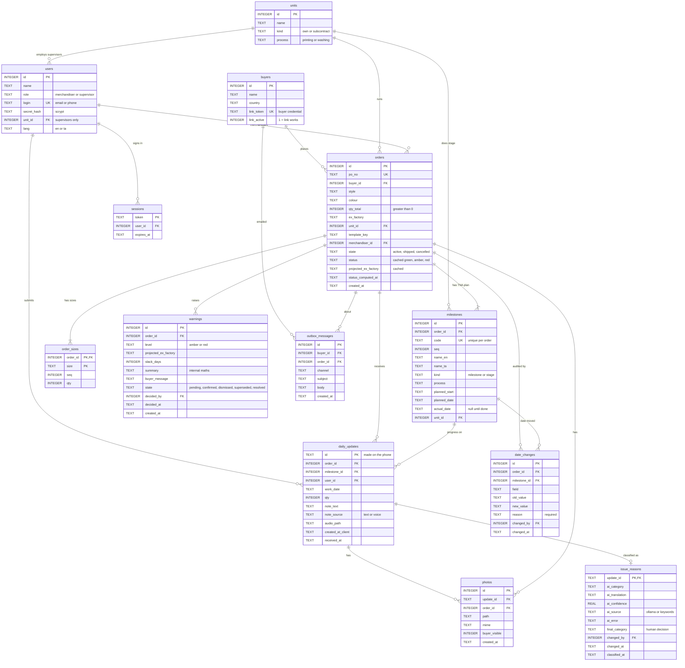

# LoomTrack database schema

SQLite, 12 tables, defined in [backend/loomtrack/db.py](../backend/loomtrack/db.py). The diagram below is a Mermaid ER diagram: it renders on GitHub, and in VS Code with the "Markdown Preview Mermaid Support" extension.

`PK` primary key, `FK` foreign key, `UK` unique. `||--o{` means one-to-many.

## Reading the diagram

| Area | Tables | Note |
|---|---|---|
| People and access | `buyers`, `users`, `sessions`, `units` | A buyer's `link_token` is their credential. A supervisor's `unit_id` limits which stages they see. |
| The plan | `orders`, `order_sizes`, `milestones` | `milestones` holds both production stages (`kind = 'stage'`) and dated checkpoints (`kind = 'milestone'`). |
| Floor data | `daily_updates`, `photos`, `issue_reasons` | `daily_updates.id` is created on the phone, so a retried offline upload hits the same key and is ignored. |
| Warnings | `warnings`, `outbox_messages` | Buyers see only `confirmed` warnings. Confirming writes a mock email to the outbox. |
| Compliance | `date_changes` | Triggers abort every UPDATE and DELETE, so the table is append-only. |

## Rules enforced by the database

- `orders.qty_total > 0`, `order_sizes.qty >= 0`, `daily_updates.qty >= 0`.
- Allowed values are checked for `units.kind`, `users.role`, `orders.state`, `milestones.kind`, `daily_updates.note_source`, `warnings.level` and `warnings.state`.
- `milestones` is unique on `(order_id, code)`, and `order_sizes` is keyed on `(order_id, size)`.
- Foreign keys are on. `order_sizes` and `milestones` are deleted with their order.
- Index: `ix_updates_ms` on `daily_updates (milestone_id, work_date)`, used by the run-rate engine.
- Dates are ISO text (`2026-11-20`), which sorts correctly.
