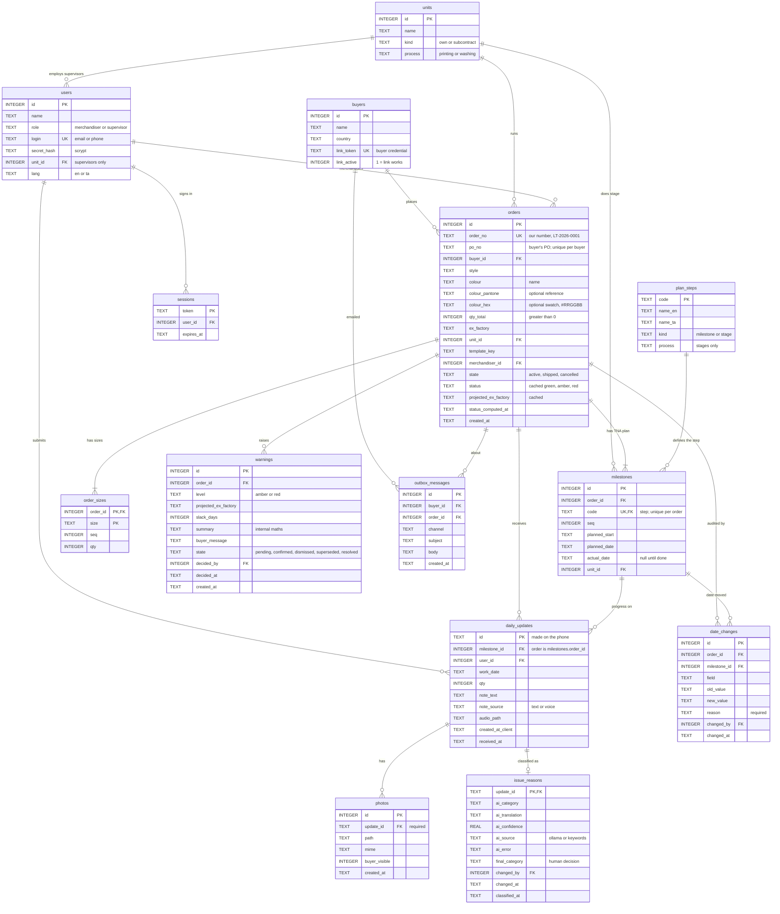

# LoomTrack database schema

SQLite, 13 tables, defined in [backend/loomtrack/db.py](../backend/loomtrack/db.py). The schema is normalised (third normal form) apart from two deliberate caches. The diagram below is a Mermaid ER diagram: it renders on GitHub, and in VS Code with the "Markdown Preview Mermaid Support" extension.

`PK` primary key, `FK` foreign key, `UK` unique. `||--o{` means one-to-many.

## Reading the diagram

| Area | Tables | Note |
|---|---|---|
| People and access | `buyers`, `users`, `sessions`, `units` | A buyer's `link_token` is their credential. A supervisor's `unit_id` limits which stages they see. |
| The plan | `orders`, `order_sizes`, `plan_steps`, `milestones` | `plan_steps` holds each kind of step once (names, stage or milestone). `milestones` is one order's plan: a row per step with that order's dates. |
| Floor data | `daily_updates`, `photos`, `issue_reasons` | `daily_updates.id` is created on the phone, so a retried offline upload hits the same key and is ignored. |
| Warnings | `warnings`, `outbox_messages` | Buyers see only `confirmed` warnings. Confirming writes a mock email to the outbox. |
| Compliance | `date_changes` | Triggers abort every UPDATE and DELETE, so the table is append-only. |

## Rules enforced by the database

- `orders.qty_total > 0`, `order_sizes.qty >= 0`, `daily_updates.qty >= 0`.
- Allowed values are checked for `units.kind`, `users.role`, `orders.state`, `milestones.kind`, `daily_updates.note_source`, `warnings.level` and `warnings.state`.
- `orders.order_no` is unique. `orders.po_no` is unique per buyer (`UNIQUE (buyer_id, po_no)`), because it is the buyer's own number. `colour_hex` must be `#` plus six uppercase hex digits.
- `milestones` is unique on `(order_id, code)`, and `milestones.code` must exist in `plan_steps`. `order_sizes` is keyed on `(order_id, size)`.
- `daily_updates` and `photos` carry no `order_id`: an update's order is its milestone's order, so there is no second copy to disagree. Every photo must belong to an update.
- Foreign keys are on. `order_sizes` and `milestones` are deleted with their order.
- Index: `ix_updates_ms` on `daily_updates (milestone_id, work_date)`, used by the run-rate engine.
- Dates are ISO text (`2026-11-20`), which sorts correctly.

## Normalisation

| What | Where it stands |
|---|---|
| Step names stored once | `plan_steps` (synced from `domain/tna.py` at startup). Fix a Tamil label in one place and every order shows it. |
| No duplicated `order_id` | Removed from `daily_updates` and `photos`. Queries reach the order through `milestones`. |
| Deliberate exceptions | `orders.status` and `projected_ex_factory` are cached results (so the board doesn't rerun the engine per row), and `warnings` keeps a snapshot of the numbers when it was raised (history). |
| `date_changes.order_id` kept | Ex-factory changes have no milestone, so the order must be stored directly. |

## Versions and migration

`PRAGMA user_version` holds the schema version (now 2). Older databases are migrated in place when the app opens them, one version at a time: one transaction, a copy saved as `<db>.v0.bak` or `.v1.bak`, and a foreign-key check afterwards.

| Version | Change |
|---|---|
| 0 to 1 | Step names moved to `plan_steps`; `order_id` removed from `daily_updates` and `photos`. |
| 1 to 2 | `orders.order_no` added and backfilled (`LT-<year>-<n>` in creation order); colour fields added; PO number made unique per buyer. |

Code: `_migrate_v0` and `_migrate_v1` in [db.py](../backend/loomtrack/db.py). Tests: [test_migration.py](../backend/tests/test_migration.py).
